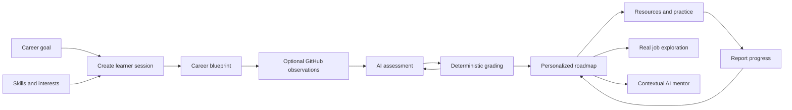
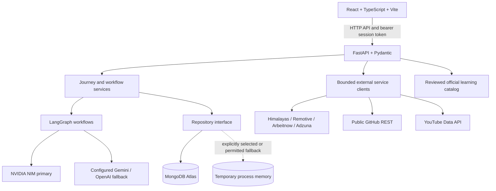

<div align="center">

# MAXIMUS

### Discover what you know. Prove what you can do. Build what comes next.

**Career intelligence connected to evidence, assessment, and your next practical step.**

An AI-powered learning platform for students, early-career professionals, and career switchers: turn a goal or a starting skill set into a personalized, revisable learning journey.

[**Open the application**](https://maximus-chi-indol.vercel.app) · [**Explore the source**](https://github.com/antoniusjairus4/Promptwarz-Rathinam-College) · [**API contract**](contracts/openapi.json)


[Experience](#the-learner-experience) · [Architecture](#system-architecture) · [AI engineering](#ai-engineering) · [Evidence](#testing-and-quality-assurance) · [Run locally](#local-development) · [Deployment](#deployment)

</div>

> **MVP status:** The application implements the complete learner workflow. Hosted inference and external providers require working credentials and connectivity. MongoDB durability is conditional; explicitly labeled memory storage is temporary. The demo frontend link is an entry point, not a claim of independently verified production availability.

## The problem

Career advice often stops at a job title. Course catalogs offer volume without direction. A self-reported skill can look indistinguishable from demonstrated knowledge, while static roadmaps ignore what a learner discovers through practice.

MAXIMUS connects these fragmented decisions: **what should I learn, what evidence do I have, what gaps should I assess, and what should I do next?** It supports both learners with a destination and learners still discovering one. Job results describe actual opportunities; they do not promise employment or professional qualification.

## Our solution

**Career discovery → assessment → competency insight → adaptive roadmap → learning resources → real opportunities → feedback.**

Learner goals, interests, experience, and weekly availability inform a career blueprint. Optional public GitHub observations add source evidence. AI-generated MCQs test selected knowledge; deterministic grading records results. Roadmaps use those results and reported practice progress. Resources and job searches use session context, and the mentor can refer to the same history.

The loop is explicit: new assessments and roadmap regeneration incorporate retained history. This is application-driven adaptation, not a claim that models train themselves on users.

## The learner experience

| Experience | Implemented behavior | Evidence boundary |
| --- | --- | --- |
| **Career-First** | Start with a target role; generate a personalized blueprint. | A suggested skill plan is not an employer certification. |
| **Skills-First** | Start from skills and interests; infer possible directions. | Self-reports remain unverified; interests do not become invented skills. |
| **Skill DNA** | Visualize learner skill information; request contextual AI profile analysis. | Distinguishes declarations, source observations, and quiz evidence. |
| **Skill Arena** | Generate relevant MCQs, submit answers, review scores and explanations. | Scores measure the current generated quiz, not professional proficiency. |
| **Career Navigator** | Generate or refresh a roadmap and record completed milestones. | Completion is learner-reported practice. |
| **Learning Hub** | Search reviewed official links and optional YouTube results. | No fabricated course listings, durations, ratings, or completions. |
| **Live Job Explorer** | Normalize, cache, filter, and deduplicate real provider listings. | Matching reports skill-term overlap, not hiring probabilities. |
| **AI Mentor** | Answer with goal, blueprint, observations, quiz gaps, roadmap, and recent conversation. | No code execution or invented external actions. |
| **Session restoration** | Restore the saved learner journey using an opaque bearer token. | Durable only when backed by working MongoDB; memory does not survive restart. |

### User journey



## System architecture



- **Frontend:** route-split React UI, centralized Axios client, session context, light/dark/system themes, charts and roadmap visualization.
- **Backend:** modular API, typed models, services, LangGraph orchestration, provider adapters, and a replaceable persistence interface.
- **Storage:** session documents retain blueprints, observations, assessments/results, roadmap/progress, mentor history, and bounded agent events. Compare-and-swap updates reject conflicting writes instead of silently overwriting them.
- **Deployment:** separate frontend and backend Vercel configurations; the current frontend template points to a temporary development tunnel. See [deployment](#deployment) for operational limits.

## AI engineering

[`HostedGenerator`](backend/app/services/inference.py) requests structured JSON and validates it against Pydantic schemas. With the default primary setting, configured providers are tried in order **NVIDIA → Gemini → OpenAI**. Missing keys or model names skip a provider. Each provider gets one attempt; SDK retries are disabled. Provider/model provenance accompanies generated artifacts, and failures retain safe categories rather than being replaced with canned success.

[`JourneyService`](backend/app/services/journey.py) constructs an explicit context allowlist: learner declarations, target role, blueprint, source findings, recent assessment history, roadmap, and completed practice. The mentor additionally receives recent conversation. Private assessment keys, token hashes, and credentials are excluded. Prompts mark repository content as untrusted and forbid invented evidence or assistance that solves an active assessment.

[`LangGraph workflows`](backend/app/agents/workflow.py) implement logical Skill Detective, Career Architect, Assessment Architect, Learning Curator, and Adaptive Mentor roles. Journey operations use tracked graph nodes, producing genuine started/completed/failed events. These are bounded orchestrations, not autonomous agents browsing or executing arbitrary programs.

| Genuine hosted inference | Deterministic application behavior |
| --- | --- |
| Career blueprint and inferred profile | Session authorization and persistence |
| Personalized assessment questions | Answer comparison and score calculation |
| Roadmap generation and contextual mentorship | Progress updates, evidence provenance, provider normalization |
| Suggested next actions | Resource filtering, job-term overlap, caching and deduplication |

**Limits:** defaults allow 30 seconds per provider within a shared 120-second AI request budget. The browser now waits **25 seconds**, so a slow generation can outlast the UI request. A timeout is shown honestly; restoring session state may recover a completed result. Output validation and prompt boundaries reduce risk but do not prove model correctness or complete prompt-injection resistance.

## Feature-to-technology matrix

| Feature / frontend source | Backend route | Implementation / integration | User value |
| --- | --- | --- | --- |
| [OnboardingPage](frontend/src/pages/OnboardingPage.tsx) | `POST /api/sessions` | [Workflow service](backend/app/services/workflow.py) | Goal-first or skills-first session |
| [CareerBlueprintCard](frontend/src/components/career/CareerBlueprintCard.tsx) | `POST /api/career/blueprint` | Journey service + hosted inference | Personalized target skill plan |
| [SkillDnaPage](frontend/src/pages/SkillDnaPage.tsx) | `POST /api/profile/analyze`, `/api/github/analyze` | [GitHub inspector](backend/app/services/github_analysis.py) + AI profile | Separate observations from inferences |
| [SkillArenaPage](frontend/src/pages/SkillArenaPage.tsx) | `POST /api/assessment/generate`, `/api/assessment/evaluate` | Graph generation + deterministic grading | Assess selected knowledge gaps |
| [CareerNavigatorPage](frontend/src/pages/CareerNavigatorPage.tsx) | `POST /api/roadmap/generate`, `/api/progress/update` | History-aware roadmap workflow | Prioritized practice and revision |
| [LearningHubPage](frontend/src/pages/LearningHubPage.tsx) | `GET /api/resources/search` | [Official catalog](backend/app/services/catalog.py), YouTube | Relevant learning links |
| [LiveJobExplorerPage](frontend/src/pages/LiveJobExplorerPage.tsx) | `GET /api/jobs/search` | [External services](backend/app/services/external.py) | Attributed opportunities with original URLs |
| [AiMentorPage](frontend/src/pages/AiMentorPage.tsx) | `POST /api/mentor/chat` | Journey context + hosted inference | Guidance grounded in learner history |
| [LearnerContext](frontend/src/context/LearnerContext.tsx) | `GET /api/sessions/{session_id}` | [Repository interface](backend/app/db/repository.py) | Restore the actual session state |

## API documentation

The checked-in [OpenAPI contract](contracts/openapi.json) contains **28 operations**, spanning session facade routes and preserved `/api/v1` routes. Actual route modules: [journey](backend/app/api/journey.py), [workflow](backend/app/api/workflow.py), and [integrations](backend/app/api/integrations.py). Health is defined in [main.py](backend/app/main.py).

| API group | Key endpoints |
| --- | --- |
| Operations | `GET /api/health`, `GET /api/v1/status` |
| Learner lifecycle | `POST /api/sessions`, `GET /api/sessions/{session_id}` |
| Career intelligence | `POST /api/career/blueprint`, `/api/profile/analyze`, `/api/github/analyze` |
| Assessment and adaptation | `POST /api/assessment/generate`, `/api/assessment/evaluate`, `/api/roadmap/generate`, `/api/progress/update` |
| Recommendations and guidance | `GET /api/resources/search`, `/api/jobs/search`; `POST /api/mentor/chat` |
| Versioned API | Learners, assessments/results, roadmaps/steps, events, public GitHub and learning/job search under `/api/v1` |

With the backend running locally, open [Swagger UI](http://127.0.0.1:8000/docs). See [frontend handoff](contracts/FRONTEND_HANDOFF.md), [schema-aligned examples](contracts/api_examples.json), and [integration notes](contracts/BOT_A_INTEGRATIONS.md). Regenerate the contract using `backend/.venv/bin/python backend/export_openapi.py` from the repository root.

## Security engineering

- **Secrets:** backend environment settings use secret types; private `.env` files are ignored. The frontend receives only the public backend URL.
- **Session isolation:** opaque bearer tokens authorize learner access; persisted tokens are hashed. This is not a complete account, recovery, or enterprise identity system.
- **Assessment integrity:** public models exclude private answer keys; explanations are returned after submission. No learner code is executed in the backend process.
- **Validation and limits:** Pydantic input checks; [middleware](backend/app/core/limits.py) caps bodies at 256 KiB, bounds body receipt, limits POST/PATCH traffic to 30 requests/minute/client and four concurrent writes **per process**. These are not distributed rate limits; proxy identity requires deployment-specific care.
- **Browser boundaries:** explicit CORS origins, safe HTTP(S) outbound links, semantic text rendering, API `no-store`/`nosniff`, and frontend response headers.
- **External requests:** fixed provider hosts, time/size bounds, independent failure states and cooldowns. GitHub source is sampled as text, never cloned and executed. Observed code does not establish authorship.
- **Failure behavior:** structured errors, bounded inference, no silent fake data, and no silent switch to empty memory after an active durable repository fails.

## Testing and quality assurance

**Recorded local verification on November 14, 2026:** 42 backend tests passed; 14 browser tests passed and one opt-in live browser test was skipped. Typecheck, lint, and production build passed. The subsequent 25-second timeout hotfix also passed the production build. These are local results, not proof that deployed providers or all live journeys are currently healthy; this documentation change does not rerun the entire suite.

| Evidence | Coverage |
| --- | --- |
| [Backend tests](backend/tests) | Workflow, grading, persistence/failure behavior, integrations, serverless entrypoint, request limits, contract consistency |
| [Browser journey suite](frontend/tests/journey.spec.ts) | Onboarding paths, restore, assessment, roadmap, profile, resources, jobs, mentor, errors and accessibility |
| [Opt-in live browser test](frontend/tests/live.spec.ts) | Real backend without route mocks; requires explicit live URL and working services |
| [Contract test](backend/tests/test_contract.py) | Exported schema consistency and documented response models |
| [QA evidence](qa_evidence) | Captured UI states; screenshots are supporting evidence, not automated pass guarantees |

Browser fixtures are test-only data. Axe checks cover selected states and WCAG rules; they do not establish complete WCAG conformance. Recorded dependency audits found no known vulnerabilities at the time of inspection; that is a point-in-time result, not a continuing guarantee.

<details>
<summary><strong>Reproduce local checks</strong></summary>

```sh
backend/.venv/bin/python -m pytest backend/tests -q
cd frontend
npm run typecheck
npm run lint
npm run build
npx playwright install chromium
npm test -- --workers=1
npm audit
# Optional: contact a real running backend, including hosted inference.
LIVE_API_URL=http://127.0.0.1:8000 npm test -- tests/live.spec.ts --workers=1
```

On machines with installed Chrome, `PLAYWRIGHT_CHANNEL=chrome npm test -- --workers=1` uses it instead. Provider-dependent tests consume real external requests and may fail independently of fixture-backed tests.

</details>

## Accessibility and UX

Implemented safeguards include labeled inputs, native MCQ radio controls, visible keyboard focus, skip navigation, route focus and document titles, announced errors/status, and a mobile dialog with focus trapping, Escape dismissal, and focus return. Light/dark themes, reduced-motion behavior, responsive layouts, and selected contrast/reflow states have browser-test coverage. Requests remain asynchronous; health/status calls share an in-flight request, and failures expose retry feedback instead of hanging indefinitely.

## Local development

Prerequisites: Python 3.11+ and a Node.js version compatible with the installed Vite toolchain; use the lockfile for frontend reproducibility.

```sh
git clone https://github.com/antoniusjairus4/Promptwarz-Rathinam-College.git
cd Promptwarz-Rathinam-College
python3 -m venv backend/.venv
backend/.venv/bin/python -m pip install -r backend/requirements.txt
# Copy only when these local files do not already exist.
test -f backend/.env || cp backend/.env.example backend/.env
test -f frontend/.env || cp frontend/.env.example frontend/.env
cd frontend
npm ci
cd ..
```

Edit `frontend/.env` to use `VITE_API_BASE_URL=http://127.0.0.1:8000` for local development. In separate terminals, from the repository root:

```sh
# Backend: one process keeps temporary demo sessions together.
backend/.venv/bin/python -m uvicorn app.main:app --app-dir backend --host 127.0.0.1 --port 8000
```

```sh
# Frontend
cd frontend
npm run dev -- --host 127.0.0.1
```

Health/startup do not require AI credentials. Configure a hosted provider to generate AI content; an unavailable provider produces an error, not a mock result. No local MongoDB server or model-weight download is required.

<details>
<summary><strong>Safe environment reference</strong></summary>

Use [backend/.env.example](backend/.env.example) and [frontend/.env.example](frontend/.env.example) as the complete templates. Never place provider credentials in `VITE_*` variables or commit private configuration.

```dotenv
# backend/.env — fill locally, never commit
PRIMARY_LLM_PROVIDER=nvidia
NVIDIA_API_KEY=
NVIDIA_MODEL=nvidia/nemotron-3.5-lightning-30b-a3b
GEMINI_API_KEY=
GEMINI_MODEL=gemini-3.5-flash
OPENAI_API_KEY=
OPENAI_MODEL=
MONGODB_URI=
MONGODB_DATABASE=maximus
STORAGE_BACKEND=auto
ALLOW_MEMORY_FALLBACK=true
FRONTEND_ORIGIN=http://localhost:5173,http://127.0.0.1:5173,https://maximus-chi-indol.vercel.app
GITHUB_TOKEN=
YOUTUBE_API_KEY=
ADZUNA_APP_ID=
ADZUNA_APP_KEY=
```

GitHub public access can operate without a token, subject to provider limits. YouTube and Adzuna require their credentials; the official catalog remains available without YouTube. Provider enable flags and timeout settings are in the backend template. Model names remain environment-configurable and subject to provider availability.

</details>

## Deployment

**Frontend:** [maximus-chi-indol.vercel.app](https://maximus-chi-indol.vercel.app), configured through [frontend/vercel.json](frontend/vercel.json). Set the public `VITE_API_BASE_URL` before building, then redeploy when it changes.

**Current template backend URL:** `https://0qgx6nbb-8000.inc1.devtunnels.ms`. A VS Code Dev Tunnel is temporary: its local FastAPI process, developer machine, and tunnel must remain running. Tunnel 504s and connectivity failures remain possible. It is not production-grade hosting.

**Vercel backend configuration:** deploy with `backend/` as project root. [index.py](backend/index.py) exposes the ASGI app; [vercel.json](backend/vercel.json) requests a 300-second maximum duration and excludes local secrets/dependencies/caches. Configuration is not proof of effective platform limits or successful deployment. See [Vercel guidance](backend/VERCEL.md) for packaging/runtime caveats.

Hosted secrets load from environment variables, not a bundled `.env`. Serverless defaults require MongoDB and disable memory fallback and Remotive unless explicitly overridden. This avoids claiming instance-local state is durable or enforcing provider-wide feed limits with ephemeral caches. A database outage can leave health available while learner operations return 503.

**Known deployment blockers:** prior `maximus-api.vercel.app` invocation failures require runtime logs to identify the cause; no successful repair is claimed here. Earlier Atlas checks encountered network connection refusal before authentication. Current Atlas availability and a complete live deployed journey were not reverified for this README. Slow AI requests may exceed the frontend's 25-second timeout even when within backend budgets.

## Evaluator evidence matrix

| Criterion | Concrete evidence |
| --- | --- |
| Problem alignment | Two onboarding paths and contextual journey in [OnboardingPage](frontend/src/pages/OnboardingPage.tsx) and [JourneyService](backend/app/services/journey.py) |
| Innovation | Evidence boundaries carried through blueprint, quiz, roadmap, and mentor context |
| Code quality | Typed [models](backend/app/models), modular services, repository protocol, exported contract |
| Security | [Request limits](backend/app/core/limits.py), hashed session tokens, private answer keys, bounded external clients |
| Efficiency | Route splitting, provider caching, request coalescing, time budgets; no unsupported latency benchmark |
| Testing | [Backend regression suite](backend/tests) and [browser tests](frontend/tests/journey.spec.ts) |
| Accessibility | Keyboard/dialog/focus behavior and automated axe checks in the browser suite |
| Technical complexity | LangGraph orchestration, multi-provider structured inference, evidence provenance, concurrency-controlled persistence |
| Scalability | Replaceable repository and stateless HTTP interface; shared caches, global limits, and reliable hosting remain future work |
| Real-world impact | Actionable practice plans and attributed real learning/job links; no claimed employment outcome study |

## Current scope and future roadmap

| Status | Scope |
| --- | --- |
| **Implemented, locally exercised** | End-to-end session workflow, structured AI generation, deterministic MCQ grading, roadmap updates, optional public integrations, context-aware mentor, UI accessibility safeguards |
| **Implemented, operationally conditional** | MongoDB persistence, provider fallback, live feeds, hosted inference, and Vercel backend execution depend on network, credentials, provider policy and deployment health |
| **Experimental / bounded evidence** | Source-pattern observations, AI-inferred career direction, and keyword-based job matching; none certify competence |
| **Planned** | Deeper competency graphs, stronger skill verification, broader resource/domain coverage, longitudinal analytics, durable production hosting, shared caches and distributed abuse protection |

The current catalog is intentionally small and official; broad career-goal generation does not imply equally broad curated resources. Repository sampling is bounded rather than exhaustive. Serverless memory cannot provide persistent learner memory across instances.

## Project and credits

Repository maintained under [antoniusjairus4](https://github.com/antoniusjairus4). No additional team identities or awards are asserted without repository evidence.

Built with React, TypeScript, Vite, FastAPI, Pydantic, LangGraph, MongoDB tooling, Playwright and axe. Hosted inference adapters support NVIDIA NIM, Gemini and OpenAI. Public data integrations credit GitHub, Himalayas, Remotive, Arbeitnow, Adzuna and YouTube; the catalog links to freeCodeCamp, MIT OpenCourseWare, Python documentation and MDN. Availability and use remain subject to each provider's terms. Original job application URLs and source attribution are retained; integrations do not imply endorsement.

---

<div align="center">

**Turn career advice into a learning journey you can inspect, practice, and improve.**

[Explore MAXIMUS](https://maximus-chi-indol.vercel.app) · [Read the implementation](https://github.com/antoniusjairus4/Promptwarz-Rathinam-College)

</div>
