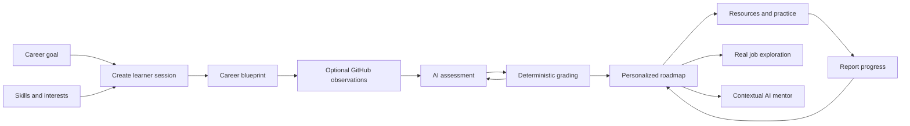
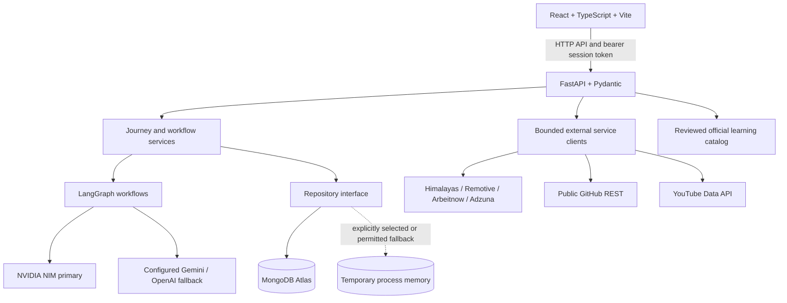

<div align="center">

# MAXIMUS

### Discover what you know. Prove what you can do. Build what comes next.

**Career intelligence connected to evidence, assessment, and your next practical step.**

An AI-powered learning platform for students, early-career professionals, and career switchers: turn a goal or a starting skill set into a personalized, revisable learning journey.

[**Open the application**](https://maximus-chi-indol.vercel.app) · [**Explore the source**](https://github.com/antoniusjairus4/Promptwarz-Rathinam-College) · [**API contract**](contracts/openapi.json)


[Experience](#the-learner-experience) · [Architecture](#system-architecture) · [AI engineering](#ai-engineering) · [Evidence](#testing-and-quality-assurance) · [Run locally](#local-development) · [Deployment](#deployment)

</div>

> **Verified engineering evidence — November 14, 2026:** **50 backend tests passed · 19 browser regressions passed · production build and lint passed · real Atlas restart persistence passed · both real-provider learner journeys passed · five-question AI interview browser flow passed.** Each result below identifies its test environment and evidence.

## The problem

Career advice often stops at a job title. Course catalogs offer volume without direction. A self-reported skill can look indistinguishable from demonstrated knowledge, while static roadmaps ignore what a learner discovers through practice.

MAXIMUS connects these fragmented decisions: **what should I learn, what evidence do I have, what gaps should I assess, and what should I do next?** It supports both learners with a destination and learners still discovering one. Job results describe actual opportunities; they do not promise employment or professional qualification.

## Our solution

**Career discovery → assessment → competency insight → adaptive roadmap → learning resources → real opportunities → feedback.**

Learner goals, interests, experience, and weekly availability inform a career blueprint. Optional public GitHub observations add source evidence. AI-generated MCQs test selected knowledge; deterministic grading records results. Roadmaps use those results and reported practice progress. Resources and job searches use session context, and the mentor can refer to the same history.

The loop is explicit: new assessments and roadmap regeneration incorporate retained history. This is application-driven adaptation, not a claim that models train themselves on users.

## The learner experience

| Experience | Implemented behavior | Evidence boundary |
| --- | --- | --- |
| **Career-First** | Start with a target role; generate a personalized blueprint. | A suggested skill plan is not an employer certification. |
| **Skills-First** | Start from skills and interests; infer possible directions. | Self-reports remain unverified; interests do not become invented skills. |
| **Skill DNA** | Visualize learner skill information; request contextual AI profile analysis. | Distinguishes declarations, source observations, and quiz evidence. |
| **Skill Arena** | Generate relevant MCQs, submit answers, review scores and explanations. | Scores measure the current generated quiz, not professional proficiency. |
| **Career Navigator** | Generate or refresh a roadmap and record completed milestones. | Completion is learner-reported practice. |
| **Learning Hub** | Search reviewed official links and optional YouTube results. | No fabricated course listings, durations, ratings, or completions. |
| **Live Job Explorer** | Normalize, cache, filter, and deduplicate real provider listings. | Matching reports skill-term overlap, not hiring probabilities. |
| **AI Mentor** | Answer with goal, blueprint, observations, quiz gaps, roadmap, and recent conversation. | No code execution or invented external actions. |
| **Session restoration** | Restore the saved learner journey using an opaque bearer token. | Durable only when backed by working MongoDB; memory does not survive restart. |

### User journey



## System architecture



- **Frontend:** route-split React UI, centralized Axios client, session context, light/dark/system themes, charts and roadmap visualization.
- **Backend:** modular API, typed models, services, LangGraph orchestration, provider adapters, and a replaceable persistence interface.
- **Storage:** session documents retain blueprints, observations, assessments/results, roadmap/progress, mentor history, and bounded agent events. Compare-and-swap updates reject conflicting writes instead of silently overwriting them.
- **Deployment:** separate frontend and backend Vercel configurations; the current frontend template points to a temporary development tunnel. See [deployment](#deployment) for operational limits.

## AI engineering

[`HostedGenerator`](backend/app/services/inference.py) requests structured JSON and validates it against Pydantic schemas. With the default primary setting, configured providers are tried in order **NVIDIA → Gemini → OpenAI**. Missing keys or model names skip a provider. Each provider gets one attempt; SDK retries are disabled. Provider/model provenance accompanies generated artifacts, and provider diagnostics retain safe categories.

[`JourneyService`](backend/app/services/journey.py) constructs an explicit context allowlist: learner declarations, target role, blueprint, source findings, recent assessment history, roadmap, and completed practice. The mentor additionally receives recent conversation. Private assessment keys, token hashes, and credentials are excluded. Prompts mark repository content as untrusted and forbid invented evidence or assistance that solves an active assessment.

[`LangGraph workflows`](backend/app/agents/workflow.py) implement logical Skill Detective, Career Architect, Assessment Architect, Learning Curator, and Adaptive Mentor roles. Journey operations use tracked graph nodes, producing genuine execution events. These are bounded orchestrations, not autonomous agents browsing or executing arbitrary programs.

| Genuine hosted inference | Deterministic application behavior |
| --- | --- |
| Career blueprint and inferred profile | Session authorization and persistence |
| Personalized assessment questions | Answer comparison and score calculation |
| Roadmap generation and contextual mentorship | Progress updates, evidence provenance, provider normalization |
| Suggested next actions | Resource filtering, job-term overlap, caching and deduplication |

**Bounded AI execution:** defaults allow 30 seconds per provider within a shared 120-second request budget. Ordinary browser requests use 25 seconds, single AI operations use 60 seconds, and multi-agent assessment/roadmap calls use 120 seconds. Pydantic validates structured outputs; source context is explicitly treated as untrusted data.

## Feature-to-technology matrix

| Feature / frontend source | Backend route | Implementation / integration | User value |
| --- | --- | --- | --- |
| [OnboardingPage](frontend/src/pages/OnboardingPage.tsx) | `POST /api/sessions` | [Workflow service](backend/app/services/workflow.py) | Goal-first or skills-first session |
| [CareerBlueprintCard](frontend/src/components/career/CareerBlueprintCard.tsx) | `POST /api/career/blueprint` | Journey service + hosted inference | Personalized target skill plan |
| [SkillDnaPage](frontend/src/pages/SkillDnaPage.tsx) | `POST /api/profile/analyze`, `/api/github/analyze` | [GitHub inspector](backend/app/services/github_analysis.py) + AI profile | Separate observations from inferences |
| [SkillArenaPage](frontend/src/pages/SkillArenaPage.tsx) | `POST /api/assessment/generate`, `/api/assessment/evaluate` | Graph generation + deterministic grading | Assess selected knowledge gaps |
| [CareerNavigatorPage](frontend/src/pages/CareerNavigatorPage.tsx) | `POST /api/roadmap/generate`, `/api/progress/update` | History-aware roadmap workflow | Prioritized practice and revision |
| [LearningHubPage](frontend/src/pages/LearningHubPage.tsx) | `GET /api/resources/search` | [Official catalog](backend/app/services/catalog.py), YouTube | Relevant learning links |
| [LiveJobExplorerPage](frontend/src/pages/LiveJobExplorerPage.tsx) | `GET /api/jobs/search` | [External services](backend/app/services/external.py) | Attributed opportunities with original URLs |
| [AiMentorPage](frontend/src/pages/AiMentorPage.tsx) | `POST /api/mentor/chat` | Journey context + hosted inference | Guidance grounded in learner history |
| [LearnerContext](frontend/src/context/LearnerContext.tsx) | `GET /api/sessions/{session_id}` | [Repository interface](backend/app/db/repository.py) | Restore the actual session state |

## API documentation

AI Mock Interview adds five-question technical, behavioral, or mixed practice with browser voice input, editable text fallback, structured AI feedback, and session-backed results. See the [additive interview contract](contracts/INTERVIEW_HANDOFF.md). Ratings are practice feedback, not verified competence.

The checked-in [OpenAPI contract](contracts/openapi.json) contains **33 operations**, spanning session facade routes and preserved `/api/v1` routes. Actual route modules: [journey](backend/app/api/journey.py), [workflow](backend/app/api/workflow.py), and [integrations](backend/app/api/integrations.py). Health is defined in [main.py](backend/app/main.py).

| API group | Key endpoints |
| --- | --- |
| Operations | `GET /api/health`, `GET /api/v1/status` |
| Learner lifecycle | `POST /api/sessions`, `GET /api/sessions/{session_id}` |
| Career intelligence | `POST /api/career/blueprint`, `/api/profile/analyze`, `/api/github/analyze` |
| Assessment and adaptation | `POST /api/assessment/generate`, `/api/assessment/evaluate`, `/api/roadmap/generate`, `/api/progress/update` |
| Recommendations and guidance | `GET /api/resources/search`, `/api/jobs/search`; `POST /api/mentor/chat` |
| Versioned API | Learners, assessments/results, roadmaps/steps, events, public GitHub and learning/job search under `/api/v1` |

With the backend running locally, open [Swagger UI](http://127.0.0.1:8000/docs). See [frontend handoff](contracts/FRONTEND_HANDOFF.md), [schema-aligned examples](contracts/api_examples.json), and [integration notes](contracts/BOT_A_INTEGRATIONS.md). Regenerate the contract using `backend/.venv/bin/python backend/export_openapi.py` from the repository root.

## Security engineering

- **Secrets:** backend environment settings use secret types; private `.env` files are ignored. The frontend receives only the public backend URL.
- **Session isolation:** opaque bearer tokens authorize learner access; persisted tokens are hashed. This is not a complete account, recovery, or enterprise identity system.
- **Assessment integrity:** public models exclude private answer keys; explanations are returned after submission. No learner code is executed in the backend process.
- **Validation and limits:** Pydantic input checks; [middleware](backend/app/core/limits.py) caps bodies at 256 KiB, bounds body receipt, limits POST/PATCH traffic to 30 requests/minute/client and four concurrent writes **per process**. These are not distributed rate limits; proxy identity requires deployment-specific care.
- **Browser boundaries:** explicit CORS origins, safe HTTP(S) outbound links, semantic text rendering, API `no-store`/`nosniff`, and frontend response headers.
- **External requests:** fixed provider hosts, time/size bounds, independent provider states and cooldowns. GitHub source is sampled as text, never cloned and executed. Observed code does not establish authorship.
- **Data integrity:** structured responses, bounded inference, genuine provider output and preservation of the selected durable repository.

## Testing and quality assurance

### Verified passing results

Results recorded on **November 14, 2026**. Regression fixtures, real-provider integration checks, and deployed-site observations are identified separately.

| Verification | Passing evidence | Environment / source |
| --- | --- | --- |
| **Backend regression suite** | **50 tests passed** across workflows, contracts, repositories, integrations, serverless startup and request safeguards | Local pytest · [backend/tests](backend/tests) |
| **Browser regression suite** | **19 tests passed** covering onboarding, assessment, roadmap, mentor, resources, jobs, restoration and accessibility | Local Chrome + Playwright · [journey tests](frontend/tests/journey.spec.ts), [interview tests](frontend/tests/interview.spec.ts) · explicitly synthetic API fixtures |
| **Focused restoration and import checks** | **2 targeted checks passed** for credential-preserving restoration retry and session-linked GitHub observations | Local Chrome · [journey tests](frontend/tests/journey.spec.ts) |
| **Production build** | TypeScript compilation and Vite production bundle completed successfully | `npm run build` |
| **Static analysis** | ESLint completed successfully | `npm run lint` |
| **Actual Atlas connectivity** | DNS resolution, TCP connectivity to three Atlas nodes, and authenticated database ping passed | Real configured MongoDB Atlas cluster |
| **Cross-process persistence** | Created a real learner in one Python process and restored identical data in a fresh Python process; both reported `durable: true` | Real Atlas · [verify_persistence.py](backend/verify_persistence.py) |
| **Career-First integration** | Onboarding → GitHub → AI profile → blueprint → assessment → grading → roadmap → progress → resources → jobs → contextual mentor → session restoration passed | Real backend/providers + Atlas · [verify_journey.py](backend/verify_journey.py) |
| **Skills-First integration** | The same complete backend journey passed using skills/interests as its starting context | Real backend/providers + Atlas · [verify_journey.py](backend/verify_journey.py) |
| **Primary and fallback inference** | NVIDIA generated genuine journey artifacts; Gemini returned a genuine contextual mentor response during the Career-First check | Real hosted inference |
| **AI Mock Interview** | Five generated questions, five evaluated answers, summary generation and browser-refresh restoration passed with `durable: true` | Real local browser + hosted AI + Atlas · [interview test](frontend/tests/interview.spec.ts) |
| **Actual portfolio import** | `antoniusjairus4/portfolio` returned **22 source-backed findings**; username discovery returned **two repositories** | Real GitHub through the configured Dev Tunnel |
| **Learning integrations** | Returned **eight learning resources**, including official catalog links and working YouTube search | Real backend integration checks |
| **Job integrations** | Returned **20 real listings** with successful Himalayas, Remotive, Arbeitnow and Adzuna provider states | Real backend integration checks |
| **OpenAPI consistency** | Actual response models and the exported **33-operation** schema passed contract checks | [test_contract.py](backend/tests/test_contract.py), [openapi.json](contracts/openapi.json) |
| **Secret hygiene** | Pending-source scans passed against configured secret values and credential patterns before push | Source-only checks; private environment files remain ignored |
| **Frontend delivery** | Vercel reported successful deployment checks; the live site served the updated recovery bundle and created a learner with HTTP 201 | Deployed frontend observation; scoped to those verified actions |

### What the regression suite exercises

- **Learner lifecycle:** Career-First and Skills-First inputs, interests-only onboarding, correct session response handling, saved-state restoration, and immediate onboarding independent of AI generation.
- **Assessment correctness:** typed question generation, private answer-key separation, deterministic grading, explanations after submission, quiz-scoped evidence and percentage display.
- **Adaptive learning:** roadmap generation, retained practice context, milestone progress, contextual resources, skill-term job matching and original application links.
- **Persistence integrity:** optimistic concurrency, database-backed restoration, current storage-health reporting and preservation of existing learner documents.
- **GitHub efficiency:** bounded concurrent source retrieval, same-key request coalescing, shallow tree sampling, source SHA provenance and restoration of saved observations.
- **AI and voice experience:** genuine provider selection, structured output validation, editable approved transcripts, recording controls, text fallback, constructive feedback and interview-summary restoration.
- **Accessibility:** native keyboard-operable MCQs, labeled forms, visible focus, mobile dialog focus containment, Escape dismissal, theme states, selected color-contrast rules and mobile reflow.
- **Request safeguards:** body-size enforcement, bounded request receipt, per-process write limits, concurrency backpressure, health availability and CORS behavior.

### Reproduce the checks

```sh
# From the repository root
backend/.venv/bin/python -m pytest backend/tests -q
backend/.venv/bin/python backend/verify_persistence.py
backend/.venv/bin/python backend/verify_journey.py --base-url http://127.0.0.1:8000 --track both

cd frontend
npm run typecheck
npm run lint
npm run build
npx playwright install chromium
npm test -- --workers=1
```

<details>
<summary><strong>Explicit real-provider browser checks</strong></summary>

```sh
# Use installed Chrome, or omit PLAYWRIGHT_CHANNEL after installing Chromium.
PLAYWRIGHT_CHANNEL=chrome LIVE_API_URL=http://127.0.0.1:8014 npm test -- tests/interview.spec.ts --grep 'live AI interview' --workers=1
PRODUCTION_SITE_URL=https://maximus-chi-indol.vercel.app PLAYWRIGHT_CHANNEL=chrome npm test -- tests/production.spec.ts --workers=1
```

The local browser backend must allow `http://127.0.0.1:4175`. Live checks create labeled learner sessions and consume hosted-provider quota. The deployed-site test is a separate opt-in verification command; the passing matrix above states exactly which deployed actions were observed.

</details>

## Accessibility and UX

Implemented safeguards include labeled inputs, native MCQ radio controls, visible keyboard focus, skip navigation, route focus and document titles, announced errors/status, and a mobile dialog with focus trapping, Escape dismissal, and focus return. Light/dark themes, reduced-motion behavior, responsive layouts, and selected contrast/reflow states have browser-test coverage. Requests remain asynchronous. Health/status and same-session restoration calls share in-flight requests. Session restoration retains credentials and exposes a retry action. Ordinary calls wait 25 seconds; single AI operations allow 60 seconds, and multi-agent assessment/roadmap generation allows 120 seconds. GitHub source inspection has a 20-second backend deadline and returns genuine partial observations.

## Local development

Prerequisites: Python 3.11+ and a Node.js version compatible with the installed Vite toolchain; use the lockfile for frontend reproducibility.

```sh
git clone https://github.com/antoniusjairus4/Promptwarz-Rathinam-College.git
cd Promptwarz-Rathinam-College
python3 -m venv backend/.venv
backend/.venv/bin/python -m pip install -r backend/requirements.txt
# Copy only when these local files do not already exist.
test -f backend/.env || cp backend/.env.example backend/.env
test -f frontend/.env || cp frontend/.env.example frontend/.env
cd frontend
npm ci
cd ..
```

Edit `frontend/.env` to use `VITE_API_BASE_URL=http://127.0.0.1:8000` for local development. In separate terminals, from the repository root:

```sh
# Backend: one process keeps temporary demo sessions together.
backend/.venv/bin/python -m uvicorn app.main:app --app-dir backend --host 127.0.0.1 --port 8000
```

```sh
# Frontend
cd frontend
npm run dev -- --host 127.0.0.1
```

Onboarding creates a session immediately; blueprint generation is an explicit dashboard action, so provider latency cannot hold onboarding hostage. Health/startup do not require AI credentials. Configure a hosted provider to generate AI content; hosted inference returns genuine, schema-validated results. No local MongoDB server or model-weight download is required.

<details>
<summary><strong>Safe environment reference</strong></summary>

Use [backend/.env.example](backend/.env.example) and [frontend/.env.example](frontend/.env.example) as the complete templates. Never place provider credentials in `VITE_*` variables or commit private configuration.

```dotenv
# backend/.env — fill locally, never commit
PRIMARY_LLM_PROVIDER=nvidia
NVIDIA_API_KEY=
NVIDIA_MODEL=nvidia/nemotron-3.5-lightning-30b-a3b
GEMINI_API_KEY=
GEMINI_MODEL=gemini-3.5-flash
OPENAI_API_KEY=
OPENAI_MODEL=
MONGODB_URI=
MONGODB_DATABASE=maximus
STORAGE_BACKEND=auto
ALLOW_MEMORY_FALLBACK=true
FRONTEND_ORIGIN=http://localhost:5173,http://127.0.0.1:5173,https://maximus-chi-indol.vercel.app
GITHUB_TOKEN=
YOUTUBE_API_KEY=
ADZUNA_APP_ID=
ADZUNA_APP_KEY=
```

GitHub public access can operate without a token, subject to provider limits. YouTube and Adzuna require their credentials; the official catalog remains available without YouTube. Provider enable flags and timeout settings are in the backend template. Model names remain environment-configurable and subject to provider availability.

</details>

## Deployment

**Frontend:** [maximus-chi-indol.vercel.app](https://maximus-chi-indol.vercel.app), configured through [frontend/vercel.json](frontend/vercel.json). Set the public `VITE_API_BASE_URL` before building, then redeploy when it changes.

**Active backend:** FastAPI is exposed at `https://0qgx6nbb-8000.inc1.devtunnels.ms` through VS Code Dev Tunnels. Keep the local backend process, developer machine and tunnel running for this development deployment.

**Vercel-ready backend entrypoint:** [index.py](backend/index.py) exposes the ASGI app; [vercel.json](backend/vercel.json) requests a 300-second maximum duration and excludes private environment files and local artifacts. The serverless entrypoint and credential-independent health route have regression coverage. See [deployment instructions](backend/VERCEL.md).

**Verified storage:** Atlas authenticated ping and cross-process profile restoration passed. `/api/v1/status` exposes the selected repository and its current durability. Serverless defaults select MongoDB; local development supports explicitly labeled temporary storage.

**Verified frontend delivery:** Vercel deployment checks passed, the public site served the updated bundle, and live session creation returned HTTP 201. Full workflow and interview results in the test matrix identify their actual backend/browser environments.

## Evaluator evidence matrix

| Criterion | Concrete evidence |
| --- | --- |
| Problem alignment | Two onboarding paths and contextual journey in [OnboardingPage](frontend/src/pages/OnboardingPage.tsx) and [JourneyService](backend/app/services/journey.py) |
| Innovation | Evidence boundaries carried through blueprint, quiz, roadmap, and mentor context |
| Code quality | Typed [models](backend/app/models), modular services, repository protocol, exported contract |
| Security | [Request limits](backend/app/core/limits.py), hashed session tokens, private answer keys, bounded external clients |
| Efficiency | Route splitting, provider caching, request coalescing, time budgets; no unsupported latency benchmark |
| Testing | [Backend regression suite](backend/tests) and [browser tests](frontend/tests/journey.spec.ts) |
| Accessibility | Keyboard/dialog/focus behavior and automated axe checks in the browser suite |
| Technical complexity | LangGraph orchestration, multi-provider structured inference, evidence provenance, concurrency-controlled persistence |
| Scalability | Replaceable repository and stateless HTTP interface; shared caches, global limits, and reliable hosting remain future work |
| Real-world impact | Actionable practice plans and attributed real learning/job links; no claimed employment outcome study |

## Current scope and future roadmap

| Status | Scope |
| --- | --- |
| **Implemented, locally exercised** | End-to-end session workflow, structured AI generation, deterministic MCQ grading, roadmap updates, optional public integrations, context-aware mentor, UI accessibility safeguards |
| **Verified integrations** | Atlas persistence, real NVIDIA/Gemini inference, attributed GitHub observations, official learning links, YouTube search and live job providers |
| **Experimental / bounded evidence** | Source-pattern observations, AI-inferred career direction, and keyword-based job matching; none certify competence |
| **Planned** | Deeper competency graphs, stronger skill verification, broader resource/domain coverage, longitudinal analytics, durable production hosting, shared caches and distributed abuse protection |

The learning catalog uses reviewed official links. Repository analysis uses a bounded source sample with per-file provenance. MongoDB provides the durable learner-memory implementation.

## Project and credits

Repository maintained under [antoniusjairus4](https://github.com/antoniusjairus4). Project attribution follows the repository maintainer information.

Built with React, TypeScript, Vite, FastAPI, Pydantic, LangGraph, MongoDB tooling, Playwright and axe. Hosted inference adapters support NVIDIA NIM, Gemini and OpenAI. Public data integrations credit GitHub, Himalayas, Remotive, Arbeitnow, Adzuna and YouTube; the catalog links to freeCodeCamp, MIT OpenCourseWare, Python documentation and MDN. Availability and use remain subject to each provider's terms. Original job application URLs and source attribution are retained; integrations do not imply endorsement.

---

<div align="center">

**Turn career advice into a learning journey you can inspect, practice, and improve.**

[Explore MAXIMUS](https://maximus-chi-indol.vercel.app) · [Read the implementation](https://github.com/antoniusjairus4/Promptwarz-Rathinam-College)

</div>
